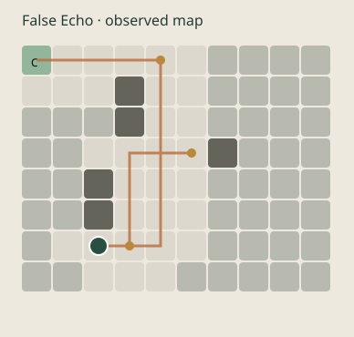
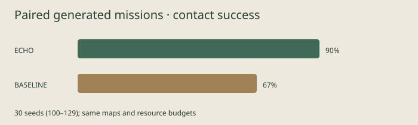

# ECHO — Finding EVE

**An autonomous search agent that reasons under uncertainty.**

ECHO is a small simulation of an autonomous search agent. WALL-E explores an unknown environment using noisy signal readings while managing limited battery. The main idea is to observe how new evidence changes an agent's beliefs and decisions.

Built for the VinnovateIT AI/ML recruitment challenge, **WALL-E and EVE's Signal**, by Prashanth Manokar.


## Run it

Requires **Python 3.9 or newer** and a modern browser. No third-party Python packages, frontend build, API keys, or paid services.

```sh
git clone https://github.com/prashanthmanokar2026/eve-signal-agent.git
cd eve-signal-agent
python3 -m echo serve
```

Open **http://127.0.0.1:8766**. Select a mission, start or single-step, and watch the belief heatmap and reasoning. Pause/resume, reset, speed selection and JSON export are available. Stop the server with Ctrl+C. If the port is busy, use `python3 -m echo serve --port 8767`.

On Windows, replace `python3` with `py`. An optional virtual environment is `python3 -m venv .venv`; installation is otherwise unnecessary. Run commands from the repository root.

## What it does

- Explores a partially observed grid, revealing only the current cell and four neighbors.
- Updates a probability distribution over EVE's possible location using noisy range measurements.
- Uses A* on discovered traversable cells and a belief/frontier/clue scoring heuristic to choose targets.
- Checks the energy and time needed to search **and return**, and recharges at discovered stations.
- Investigates discovered clues for a more reliable range and a noisy status hint.
- Records every action, observation, target, score, safety reserve and belief summary.
- Confirms EVE only through direct contact; a high model probability alone is not success.

The console uses real Python simulation state. Unknown terrain remains hidden. Warm cells indicate higher location probability; the legend's maximum changes with the posterior. Hover a tile for its exact probability. The original robot icon and field graphics are drawn with SVG; no film assets are used.

## Three missions, actual runs

| Mission | Result | Actions | Energy consumed | Scans | Clues | Recharges |
|---|---|---:|---:|---:|---:|---:|
| First Contact | Found, stranded | 22 | 26 | 4 | 2 | 0 |
| False Echo | Found, damaged | 44 | 47 | 4 | 3 | 1 |
| The Last Charge | Found, ready | 44 | 46 | 5 | 3 | 3 |

Each folder under [`results/`](results/) contains the real JSONL trace, initial briefing, JSON/Markdown report, and observed-path SVG. Energy consumed is cumulative; it can exceed battery capacity after recharging.

**Belief revision in False Echo.** Its external initial hint points toward `[8, 1]`. At action 7, a clue shifts the most likely location to `[2, 6]`. The next target becomes `[4, 1]`; withholding only that clue's evidence produces `[5, 0]` instead. The counterfactual test verifies that the new evidence changes the next target. See [the recorded example](results/false-echo/revision.json).



## How it works

```text
JSON mission → Environment (hidden truth)
                    ↓ local observations only
              Agent → Bayesian belief update
                    → target scoring + known-map A*
                    → battery/time check → chosen action
                    ↓
              Runner → trace, report, local UI
```

`echo/environment.py` owns the hidden map, clues, EVE and seeded sensor. `echo/planner.py` receives a separate, allowlisted public briefing and observations. It does not receive the world, EVE's coordinates, clue placement or seed. This is a tested software boundary, not a sandbox against malicious Python code.

See [ALGORITHMS.md](ALGORITHMS.md) for the exact sensor likelihood, scoring formula, safety policy and limitations.

## Headless runs and experiments

```sh
python3 -m echo run missions/first-contact.json --output results/first-contact
python3 -m echo run missions/false-echo.json --output results/false-echo
python3 -m echo run missions/last-charge.json --output results/last-charge
python3 scripts/revision_example.py
python3 -m echo run missions/false-echo.json --baseline --output results/baseline-demo
python3 -m echo evaluate --count 30 --seed 100 --output results/benchmark
python3 -m unittest discover -s tests -v
```

The 30 paired generated missions (seeds 100–129) produced **27/30 contact successes for ECHO** and **20/30 for the systematic baseline**. ECHO averaged 64.2 actions; the baseline averaged 105.9. Individual losses and unsuccessful runs are retained. Read [EXPERIMENTS.md](EXPERIMENTS.md) before interpreting these numbers.



## Mission configuration

JSON only. Coordinates are zero-based `[x, y]`, with `(0, 0)` at the upper left. `.` is traversable, `#` an obstacle, `C` a charger. A minimal explicit mission:

```json
{
  "name": "Small search", "seed": 7,
  "grid": ["C....", "..#..", "....."],
  "start": [0, 0], "eve": [4, 2], "eve_status": "stranded",
  "clues": [[2, 0]],
  "battery_capacity": 20, "initial_battery": 20,
  "time_budget": 60, "max_actions": 100,
  "mission_time": 0,
  "initial_signal": {"direction": "E", "strength": 0.6, "timestamp": 0},
  "sensor": {"outlier_rate": 0.2},
  "action_costs": {
    "move": [1, 1], "scan": [2, 1], "investigate": [1, 1],
    "recharge": [0, 3], "end": [0, 0]
  }
}
```

Costs are `[energy, time]`. Time is in simulation units. Recharge restores capacity and costs time; it is legal only on `C`. `end` is free. Illegal actions do not consume resources. An unaffordable legal action ends the mission with `resource_exhausted`.

Grid sides must be 2–30 cells. Clues and EVE must occupy traversable cells, but disconnected missions are allowed to test failure. Status is `ready`, `stranded` or `damaged`. Initial signal may use `coordinates` instead of `direction` (`N/E/S/W`). Its strength and age shape a soft prior, not confirmed evidence. Timestamp and `mission_time` use the same nonnegative simulation clock.

With no `grid`, `{"seed": 123}` generates a 12×9 world, hidden clues, EVE, and two stations. The seed controls placement and sensor randomness. See [`config.py`](echo/config.py) for defaults. The console discovers JSON files in `missions/` at server startup; restart after adding a file. Headless execution accepts any valid file path.

## Project map

| File | Purpose |
|---|---|
| `echo/config.py` | Validation, seeded maps, public briefing |
| `echo/environment.py` | Legal actions, resources, hidden truth, observations |
| `echo/belief.py` | Sensor likelihood and Bayesian location/status updates |
| `echo/planner.py` | A*, exploration scores and return/recharge policy |
| `echo/runner.py` | Observe → decide → act loop, snapshots and exports |
| `echo/evaluate.py` | Baseline comparison, CSV and SVG chart |
| `echo/server.py`, `web/` | Loopback HTTP API and custom HTML/CSS/JS console |
| `tests/` | Simulator, inference, planner, replay and HTTP tests |


## Limits and next steps

- EVE is stationary. Range uses Manhattan distance even through walls; this is a synthetic radio model, not a physical propagation simulator.
- Uniform interference models occasional false readings. The misleading initial coordinate hint is supplied by the scenario. There is no persistent adversarial transmitter or spoof-detection claim.
- Target scoring approximates useful exploration; it does **not** calculate expected information gain or an optimal policy. Safety is based only on known routes.
- The baseline intentionally does not scan. It shares the same world, observations, clue handling, Bayesian reporting and safety code. The experiment compares complete policies, not a clean isolation of every component.
- Confidence is conditional on the assumed sensor/prior model; it is not externally calibrated. Clue reliability is a simulator assumption. Status hints can be wrong.
- Some generated searches fail to make contact within the budget even when the location estimate is correct. Success is never guaranteed.
- The local server is for a single-person demonstration, not internet deployment. Sessions live in memory; reset creates a fresh session. Pause stops scheduling new actions; an already accepted action may finish. Export before stopping the server.
- GitHub's static hosting cannot execute this Python backend. Clone and run locally.

Useful next improvements: exact expected information gain for candidate scan positions, sensor calibration experiments, a matched-scan baseline, and a model for a moving target. Multi-agent search, LLMs, neural networks and physics simulation are intentionally outside this submission.
